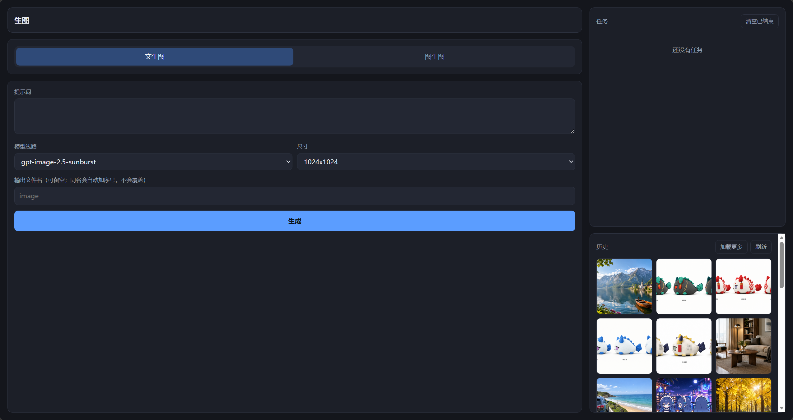
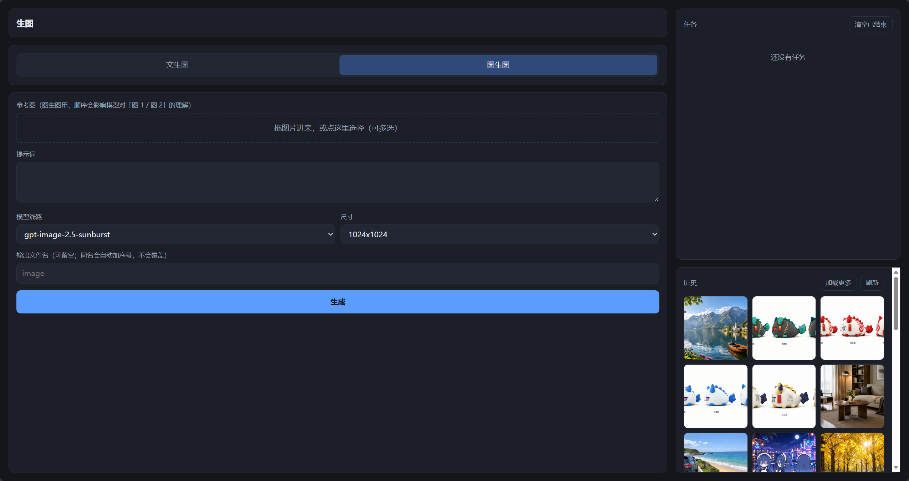

# API Image Generator

本地跑的 AI 文生图 / 图生图工作台。在浏览器里操作，通过 API 调用模型，生成的图存在自己电脑上。

后端 FastAPI，前端原生 JS由克劳德+deepseek老师帮忙。

## 有什么

- **网页版**（`WEB/`）—— 浏览器界面：文生图 / 图生图、多张参考图、任务排队、历史浏览
- **脚本版**（`image/`）—— 命令行直接跑的独立脚本

两条路共用同一个输出目录，所以脚本生成的图也会出现在网页的历史里。

## 快速开始

### 1. 装依赖

双击 `WEB/安装依赖.bat`（需要 Python 3.13、没有python可以直接去官网下载）。

### 2. 配置 API key

key 不写进代码，也不会进仓库。

**网页版**：不用提前配。直接双击 `WEB/启动.bat`，然后在页面**左下角的「设置」**里
填入 key 保存即可。换 key、换图片保存位置、换接口地址（base_url）都在这个面板里，
不用碰任何文件。

**脚本版**：把 `image/env.example.py` 复制一份、改名为 `env.py`，同样填上 key。

### 3. 启动

双击 `WEB/启动.bat`，会自动打开本地web端项目。

关掉那个黑窗口就是关闭服务。

PyCharm 里也可以跑：Run Configuration 指向 `WEB/app.py`，解释器选 Python 3.13。
工作目录随便设，代码里的路径都是从文件位置推导的。

## 界面速览



| | |
| --- | --- |
| 文生图 / 图生图 | 两个标签页，图生图会多出参考图上传区 |
| 参考图顺序 | **有意义的** —— 模型按顺序理解「图 1 / 图 2」 |
| 模型线路 | `-sunburst` / `-flare` / 裸名，互为备份；主线路被限流或超时会自动换 |
| 并发 | 最多 2 个同时跑，再排 4 个，超出的直接拒 |
| 输出文件名 | 可以留空；同名不覆盖，会自动加 `_2` `_3` |

## 图存到哪

默认 `image/aipicture/年月日/`，**在网页左下角的「设置」里可以随时改**，改完历史立刻从新位置读。

换目录**不会移动旧文件**：原来那个文件夹原封不动，只是界面上不再显示它，想找旧图直接去旧文件夹。
这样设计是为了避开「搬到一半失败」和「把别的文件夹里的东西挪走」这类事故。

历史是直接扫目录得到的，不维护索引文件 —— 手动删图、手动放图都会正确反映。

设置存在 `WEB/settings.json`（里面有 key，已被 `.gitignore` 排除）。也可以用环境变量临时覆盖，
但优先级低于设置面板：

```bat
set A6_OUTPUT_DIR=D:\别的地方\aipicture
```

启动时的横幅会打印实际用的目录**以及这个值是从哪来的**，看一眼就知道对不对。

## 调界面时用假图模式

真调用一次要 30~150 秒，调界面会疯掉。把 `WEB/启动.bat` 里 `set A6_MOCK=1`
那行前面的 `rem` 去掉，就会用 Pillow 本地画假图，秒级返回，不消耗额度。

## 环境变量

| 变量 | 作用 |
| --- | --- |
| `A6API_KEY` | 临时指定 key（**注意没有下划线**）。平时不用设，用网页左下角设置里的 |
| `A6_MOCK=1` | 不真调接口，本地画假图 |
| `A6_MOCK_DELAY=20` | 假图也等 20 秒，用来验证排队和并发 |
| `A6_MOCK_FAIL=1` | 让任务必定失败，用来验证错误提示的显示 |
| `A6_PORT=8765` | 换端口 |
| `A6_MAX_CONCURRENCY=2` | 同时最多几个调用 |
| `A6_MAX_QUEUE=4` | 再排几个队，超出直接拒 |
| `A6_OUTPUT_DIR=...` | 临时换输出目录；优先级低于网页设置里的 |
| `A6_BASE_URL=...` | 临时换接口地址；优先级低于网页设置里的 |
| `A6_NO_BROWSER=1` | 启动时不自动开浏览器 |

`A6API_KEY`、`A6_OUTPUT_DIR`、`A6_BASE_URL` 的优先级都是「网页设置 > 环境变量 > 内置默认」，
启动横幅会告诉你当前用的是哪个。

## 目录结构

```
WEB/                网页版
  app.py            FastAPI 服务：任务表、线程池、路由
  a6.py             客户端层：建连接、调接口、重试、存图、扫历史
  settings_store.py 用户设置（保存位置 / API key / 接口地址）的读写与校验
  static/           前端（原生 JS，无构建步骤）
  selftest.py       升级依赖后的自检
  启动.bat          双击启动
  安装依赖.bat      双击装依赖
  settings.json.example  设置的模板；真身 settings.json 由设置面板生成，不进仓库
  网页版说明.md     更详细的说明

image/              脚本版
  image2.5.py       图生图脚本
  test.py           文生图脚本
  env.example.py    本地 key 的模板（复制成 env.py）
  aipicture/        生成的图（不进仓库）
```

## 几个要知道的

- **key 不在代码里。** 网页版存在 `WEB/settings.json`（在网页设置面板里改），脚本版读 `env.py`，
  两个都被 `.gitignore` 排除，不会上传。
- **网页设置里能点「显示」看到完整 key。** 这是有意做的（本机自用，忘了 key 能当场查）。
  代价是本机页面能拿到明文，所以**服务只能监听 127.0.0.1**；一旦对外暴露，必须先把
  `app.py` 里的 `/api/settings/api-key` 端点删掉。
- **图片不进仓库。** 生成的图和 image 目录下的参考图都在忽略列表里。
  但如果把保存位置改到了仓库以外的目录，那些图自然也不归 git 管。
- **重启后正在跑的任务会消失。** 任务表在内存里；已经落盘的图不受影响，会出现在历史里。
- **取消是尽力而为。** 请求已经发出去就收不回来 —— 取消只能让结果不被采纳，省不下这一次调用和额度。
